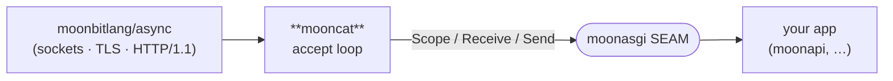

<div align="center">

# mooncat

**A native ASGI 3.0 server for MoonBit — `← uvicorn`.**

[](https://github.com/moonbitstack/mooncat/actions/workflows/ci.yml)
[](./LICENSE)
[](https://mooncakes.io/docs/moonbitstack/mooncat)

</div>

> Moved on mooncakes from `Lfan-ke/mooncat` to `moonbitstack/mooncat`.

`mooncat` runs a [`moonasgi`](https://github.com/moonbitstack/moonasgi) application over a real network socket. It sits between `moonbitlang/async`'s native HTTP transport and the ASGI SEAM: it accepts connections, turns each request into a `Scope` + `Receive` + `Send`, and drives your app — exactly the role `uvicorn` plays for Python.



## Quickstart

`serve` is native-only — it opens a socket — and it is `async`, so the entry
point is `async fn main` and the target is `--target native`:

```moonbit
async fn main {
  let app : @moonasgi.AsgiApp = (_scope, _receive, send) => {
    send(
      @moonasgi.Event::HttpResponseStart(
        status=200,
        headers=[("content-type", "text/plain; charset=utf-8")],
        trailers=false,
      ),
    )
    send(
      @moonasgi.Event::HttpResponseBody(body=b"Hello from mooncat!", more_body=false),
    )
  }
  @mooncat.serve(app, host="127.0.0.1", port=12000) catch {
    err => println("mooncat stopped: \{err}")
  }
}
```

```
moon run src/main --target native
curl http://127.0.0.1:12000
```

`moon.mod` needs `moonbitstack/mooncat` and `moonbitstack/moonasgi`; the
package importing them needs both in its `moon.pkg`. `moon run examples/00-hello
--target native` is the same program in this repository.

`serve` blocks in a keep-alive accept loop until its task is cancelled. Each request is bridged faithfully: the method/path/query/headers become an `http` `Scope`, the request body streams through `Receive`, and `HttpResponseStart` / `HttpResponseBody` events are written back via the connection.

## Command line

`uvicorn main:app --port 9000` names the app by string because Python imports
by string. MoonBit links it in, so that half does not carry over — but the half
a user types does. `@cli.run(app)` is the whole body of a server program:

```moonbit
async fn main {
  @cli.run(app) catch {
    err => println("mooncat: \{err}")
  }
}
```

```
moon run src/main --target native -- --port 9000 --log-level debug
moon run src/main --target native -- --help
```

`--help` lists every flag. The names and meanings are uvicorn's, including
`--host`, `--backlog`, `--root-path`, `--limit-concurrency`,
`--limit-max-requests`, `--timeout-keep-alive`, `--timeout-graceful-shutdown`,
`--h11-max-incomplete-event-size`, `--forwarded-allow-ips`, `--ws-max-size`,
`--ssl-certfile` with `--ssl-keyfile`, and the `--no-` form of every switch.
mooncat adds `--pfx-file` (SChannel takes PKCS#12, not PEM), `--h2c`,
`--max-connections`, `--dual-stack` and `--reuse-addr`.

A uvicorn flag mooncat cannot honour says why, rather than calling it a typo:

```
$ moon run src/main --target native -- --workers 4
mooncat: --workers: mooncat serves from one process; there is no fork here
```

That covers `--reload`, `--workers`, `--uds`, `--fd`, `--factory`, `--app-dir`,
`--interface`, `--loop`, `--http`, `--ws`, `--log-config`, `--env-file`, the
three WebSocket timing knobs, and the `--ssl-*` options beyond the two above.
Each answers with its own reason. Silently ignoring them is worse: somebody who
writes `--workers 4` would find out at load time.

`cli` is a subpackage because reading argv is a program's business, not a
library's — mooncat embedded in something larger never touches the command
line. `@mooncat.serve(app, port=12000)` is unchanged, and both ways of starting
a server stand.

`@cli.parse(argv)` on its own returns the `Plan` — a `Config`, whether to wrap
it in TLS, whether to speak h2c — without opening anything, which is how it is
tested and how a program can look at the plan before serving.

## HTTPS / TLS

`serve_tls` serves the same ASGI app over TLS (← uvicorn's `--ssl-certfile` / `--ssl-keyfile`):

```moonbit
// All three are required arguments; `serve_tls` reads the pair its platform
// accepts and ignores the other, so one call compiles everywhere.
@mooncat.serve_tls(
  app,
  certificate_file="certs/cert.pem", // PEM cert, OpenSSL platforms
  private_key_file="certs/key.pem",  // PEM key, OpenSSL platforms
  pfx_file="certs/dev.pfx",          // PKCS#12, Windows and SChannel
  port=12000,
)
```

Each accepted connection completes a real TLS handshake (`@tls.Tls`), then [`moonhttp/http1`](https://github.com/moonbitstack/moonhttp)'s RFC 9112 codec — which frames single-shot replies with `Content-Length` and streamed replies with `Transfer-Encoding: chunked`, and refuses the request-smuggling framings rather than resolving them — drives the moonasgi app over the encrypted stream. A pipelining client's second request, or a body that arrived with its head, is held for what comes next rather than dropped, with keep-alive and the lifespan protocol intact. Proven end-to-end by a real `@http` TLS client doing `GET` over `https://` and asserting `200` + body in CI. Regenerate the throwaway localhost test cert with `scripts/gen_test_cert.sh`.

**Design boundaries** (honest, not stubs):

- The certificate is supplied as **PEM** on OpenSSL platforms (Linux/macOS) and as a **PKCS#12** `.pfx` on Windows (SChannel), because that is what each `moonbitlang/async` TLS backend accepts; `serve_tls` selects the right form at compile time.
- `moonbitlang/async` exposes its **server-side** TLS constructor as `#internal` ("for internal testing only") — it is the only such entry point, and the async suite itself serves HTTPS through it — so mooncat opts into that one alert (`warnings = "-alert_internal"` in `moon.pkg`) and will migrate the moment a public API lands.
- **WebSocket over TLS (`wss://`) works**: an upgrade on a TLS connection goes through mooncat's own HTTP/1.1 and WebSocket code over the encrypted stream, with the negotiated subprotocol echoed in the 101. A test does the upgrade with a real TLS client and checks the echoed frame.

## Process model

`serve_graceful` runs the app under uvicorn's process model — a graceful shutdown and a `--reload` file watcher:

```moonbit
let handle = @mooncat.ShutdownHandle::new()
g.spawn(() => @mooncat.serve_graceful(app, @mooncat.Config::new(port=12000), handle~))
// … later, from anywhere:
handle.shutdown()   // stop accepting → drain in-flight → lifespan shutdown → close
```

`handle.shutdown()` blocks until the port is free again. The sequence is fixed and verified end-to-end in CI: a slow request that is still in flight when shutdown fires is allowed to finish (the client still sees `200`) **before** lifespan shutdown runs, and the listener is closed only afterwards — a real socket integration test pins the ordering, and a mutation test (running lifespan shutdown before the drain) turns it red. A shutdown can also come from a signal: wire `@signal.set_global_cancellation_signals` and mooncat runs lifespan shutdown + close under `protect_from_cancel` on the way down.

Every entry point (`serve`, `serve_config`, `serve_tls_config`, `serve_graceful`) runs this one loop, so they share the same limits, keep-alive, pipelining and WebSocket bridge; `serve_graceful` only adds the handle. A request body reaches the app as it arrives, one `http.request` event per piece with `more_body` until the last, so an upload is never held whole in memory; a body the app leaves unread closes the connection rather than being read as the next request. A head that cannot be parsed is answered `400` (`431` when it passes `max_head_size`) with uvicorn's `Invalid HTTP request received.` before the connection closes. A real `@websocket` client doing a text + binary round-trip against a `serve_graceful` server verifies the bridge in CI.

`reload_watch(dir, on_reload)` watches a source tree with `@fs.Watcher` and fires `on_reload` on each change — hook it to a `ShutdownHandle` to turn a file save into a graceful restart.

**Multi-worker boundary**: uvicorn's `--workers` binds the port once in the parent and hands the socket to N worker processes started with `multiprocessing`'s spawn context. `moonbitlang/async` can start a process but cannot give it a listening socket, and its event loop permits only one outstanding `accept` per listener (a second concurrent `accept` on the same handle aborts), so N in-process acceptor tasks aren't expressible either. mooncat serves from one acceptor that spawns a concurrent handler per connection, the same concurrency a single uvicorn worker gives on its event loop. Multiple workers land when the async layer can pass a listening socket to a child process.

## HTTP/2 (h2c)

`serve_h2c` serves the same ASGI app over **HTTP/2 cleartext** — the prior-knowledge, no-TLS HTTP/2 profile a client reaches with `curl --http2-prior-knowledge` or a gRPC client:

```moonbit
@mooncat.serve_h2c(app, host="127.0.0.1", port=12000)
```

The framing is [`moonhttp/http2`](https://github.com/moonbitstack/moonhttp) (RFC 9113) and the header compression `moonhttp/hpack` (RFC 7541) — the same two that carry real gRPC in moonrpc, which is why neither lives in either server. mooncat binds it to ASGI: it reads the client connection preface + SETTINGS, HPACK-decodes each request's HEADERS block into an `Http` `Scope` (the `:method` / `:path` / `:scheme` / `:authority` pseudo-headers plus the ordinary headers), streams request DATA to the app as the `Receive` body, and encodes the response — a HEADERS frame with the `:status` pseudo-header, then DATA — back over the connection. Requests multiplex on their own stream ids, and the response DATA is split to the peer's maximum frame size and clamped to the connection- and stream-level send windows, resuming on `WINDOW_UPDATE` (RFC 9113 §6.9).

Proven end to end in CI by a **real HTTP/2 (h2c) client** built on `@socket.Tcp` and the same frame + HPACK codecs: it GETs a route and reads `200` + body, POSTs a body the app echoes, drives two multiplexed streams on one connection, and — with a deliberately small advertised window — checks the server clamps each DATA frame to the granted window. The h2c greet test reuses the hand-written ASGI handler from the HTTP/1.1 test: `/greet/moon` returns JSON with `200`, and an unmatched path returns `404`.

`h2c` rather than `h2`-over-TLS because the `moonbitlang/async` TLS layer exposes no ALPN, so the protocol can't be negotiated on a TLS connection yet; h2c is the direct, ALPN-free path. The underlying dependencies provide QUIC and HTTP/3 protocol components, but mooncat does not currently expose an ASGI-over-HTTP/3 server.

## Packages

| Package | What | What it costs to link |
|:--:|:--|:--|
| `mooncat` | The accept loop, HTTP/1.1, h2c, WebSocket, TLS, the process model, `Config` | moonasgi, moonhttp's http1 / http2 / hpack / ws / upgrade, moonbitlang/async |
| `mooncat/cli` | uvicorn's flags, and `run(app)` | the above, plus core's argparse |
| `mooncat/quic` | QUIC and HTTP/3: the UDP socket, the datagram loop, the handshake QUIC does inline | moonquic, moontls, mooncred's certificate reader, moonhttp/http3 |

QUIC is separate because of that third column. It performs its own TLS 1.3
handshake rather than riding a record layer, so it is the only half of mooncat
that needs those four; a server answering HTTP/1.1 links none of them.

## Status

`v0` — HTTP/1.1 request → ASGI `Scope`/`Receive`/`Send` → response is **working and verified by a real socket round-trip in CI** (a server task answers a live `@http.get`). Landed and CI-verified alongside it:

- the **lifespan** protocol — the app runs once under a `Lifespan` scope, `startup` is driven before the listener binds and `shutdown` on the way out, even under cancellation;
- the **full WebSocket frame↔`Event` bridge** — a `Connection: upgrade` + `Upgrade: websocket` handshake becomes a `websocket` `Scope` driven through the moonasgi SEAM: `receive()` emits `websocket.connect` then real inbound text/binary frames as `WebSocketReceive` (fragments reassemble) and a peer close as `WebSocketDisconnect(code)`; `send()` turns `WebSocketAccept` into the deferred 101 handshake, `WebSocketSendText`/`WebSocketSendBytes` into message frames, and `WebSocketClose(code, reason)` into a close frame. `WebSocketAccept(subprotocol=..)` echoes the choice in the 101's `Sec-WebSocket-Protocol`. Rejecting before accept answers `403`; pings are answered and, as in uvicorn, not surfaced to the app. The receive side enforces RFC 6455 rather than trusting the peer: a set RSV bit, a reserved opcode, an unmasked client frame and a malformed control frame each fail the connection with `1002`, a payload past `ws.max_size` with `1009` — checked before the payload is read, so a 64-bit length is never truncated into a short allocation — invalid UTF-8 in a text message with `1007`, and an inbound close is echoed per §5.5.1. Proven by a **real `@websocket` client** doing a full text + binary round-trip and a clean close in CI;
- a `Config` in the shape of uvicorn's, and honoured rather than merely recorded: `dual_stack`, `reuse_addr`, per-server response `headers`, `max_connections`, `allow_failure`, `timeout_keep_alive` (an idle keep-alive connection is dropped), `limit_max_requests` (the server stops itself), `limit_concurrency` (uvicorn's `503` rather than a queue), `max_head_size` (uvicorn's `h11_max_incomplete_event_size`), `date_header`, `proxy_headers` / `forwarded_allow_ips`, and `ws.max_size`. `backlog` is the one field that does nothing: `@socket.TcpServer` calls `listen()` itself with a fixed depth and exposes no way to change it. Chunked request/response framing is handled by the codec.

mooncat also serves a small hand-written ASGI handler end to end: the HTTP/1.1 integration test answers `/greet/<name>` with JSON over a live socket, and verifies both `200` and a `404` route miss. A matching h2c test exercises the same handler over HTTP/2.

**HTTPS/TLS serving**, the **graceful-shutdown + `--reload` process model**, and **HTTP/2 (h2c) serving** landed too — see the sections above. Roadmap, transliterated from uvicorn feature-by-feature: further TLS detail (ciphers/mTLS), `h2` over TLS once the async layer exposes ALPN, multiple workers once it can pass a listening socket to a child process, `backlog` once `TcpServer` takes one, and the remaining WebSocket knobs — `ws-ping-interval` / `ws-ping-timeout` / `ws-max-queue` need a reader that can be interrupted between messages and resumed, and `ws-per-message-deflate` needs a raw DEFLATE codec the async `gzip` package does not expose.

## Native only

The `moonbitlang/async` HTTP **server** is native-only — there is no JS server backend — so `mooncat` builds and runs on the `native` target.

## License

Apache-2.0.

## What this server does not implement

The algorithms are not here. AES, GCM, SHA-1, SHA-256, HMAC, HKDF, X25519,
ECDSA and the DER codec live in
[`mooncrypt`](https://github.com/moonbitstack/mooncrypt); X.509 lives in
[`mooncred`](https://github.com/moonbitstack/mooncred); the levels and the sink
behind the log lines are
[`moonlog`](https://github.com/moonbitstack/moonlog)'s; base64 is
[`moonbase`](https://github.com/moonbitstack/moonbase)'s.

The protocol implementations come from `mooncrypt`, `mooncred`, `moontls`,
`moonhttp`, and `moonquic`. mooncat owns the server-side integration: socket
listeners, ASGI request and event bridging, graceful process handling, and TLS
and QUIC endpoint binding. It does not currently provide an ASGI-over-HTTP/3
server.

## Listening

The TCP serving entry points default to port **12000**. HTTP, HTTPS, WebSocket,
and h2c are separate server modes; each binds its own listener, so they cannot
all share that port at the same time. `Config::new(port=...)` changes the TCP
port. `quic_serve` binds the UDP address passed by the caller; UDP and TCP use
separate port spaces, so they may use the same number.
